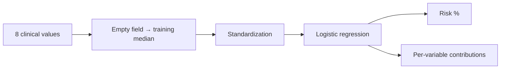

<p align="center"></p>
<h1 align="center">Diyabet Risk YZ</h1>
<p align="center"><i>5-year diabetes risk from clinical values</i></p>
<p align="center"><a href="README.md">Türkçe</a> · <b>English</b></p>
<p align="center">
  
  
  
</p>

An educational Android app that estimates the risk of developing diabetes within 5 years from age, number of pregnancies, glucose and BMI, shows how much each value contributes, and recalculates "what if?" scenarios instantly. (*Diyabet Risk YZ* = "Diabetes Risk AI".)

<p align="center">&nbsp;&nbsp;</p>

> [!IMPORTANT]
> **For educational use only.** Not for clinical diagnosis or treatment decisions.

## At a glance

| Item | Value |
| --- | --- |
| Package name | tr.saglikyz.diyabet |
| Version | 1.0 |
| Requires | Android 5.0 or later |
| Size | 33 KB |
| Internet permission | None — values never leave the device |
| Model | Logistic regression (median imputation + standardization) |
| Training data | Pima Indians Diabetes, 576 training subjects |
| Test performance | AUC 0.82 · threshold 29% (sensitivity ≥ 80%) |

**Download:** [`DiyabetRisk_YZ.apk`](DiyabetRisk_YZ.apk)

## Contents

- [Installation](#installation)
- [Step by step](#step-by-step)
- [Which value goes where?](#which-value-goes-where)
- [Reading the result](#reading-the-result)
- ["What if?"](#what-if)
- [How the app works](#how-the-app-works)
- [Things to know](#things-to-know)
- [Troubleshooting](#troubleshooting)
- [Teaching tips](#teaching-tips)
- [Data and model](#data-and-model)
- [For developers](#for-developers)

## Installation

The app is not on the Play Store; it is installed directly from the APK file. Android 5.0 or later is required.

1. Copy `DiyabetRisk_YZ.apk` to the phone (WhatsApp, e-mail, Google Drive or USB cable).
2. On the phone, tap the APK in the **Files** or **Downloads** folder.
3. If an "Install unknown apps" warning appears, tap **Settings**, turn on **Allow from this source** for the app you opened the file with (e.g. Files, Chrome), and go back.
4. Tap **Install**. If Play Protect warns about an "unrecognized developer", choose **More details → Install anyway**.
5. The app icon appears on the home screen or in the app list.

**To open it on a computer:** open `mobil/www/index.html` in Chrome or Edge; no installation or internet is needed. This is the easiest way to project the app during a lecture (for a phone-sized view press F12 → device toolbar).

> [!NOTE]
> The app interface is in Turkish. Button and label names below are given as they appear on screen, followed by an English translation.

## Step by step

1. Open the app. The three buttons at the top are real patients from the test set (#185 developed diabetes, #617 did not, #698 borderline); choosing one fills in the fields and computes the risk immediately.
2. To enter your own values, fill in the four solid-bordered fields: **Yaş** (age), **Gebelik sayısı** (number of pregnancies), **Glukoz** (glucose), **VKİ** (BMI). These are required.
3. The four dashed-bordered fields (blood pressure, pedigree score, insulin, skin fold) are optional; if left empty the training-data median is used and the result says so.
4. Tap **Riski hesapla** ("Calculate risk").

<p align="center">&nbsp;&nbsp;</p>
<p align="center"><sub>Figure 1. Left: start screen with sample patients. Right: age 45, pregnancies 2, glucose 150, BMI 31 entered by hand.</sub></p>

## Which value goes where?

| Field (on screen) | Unit | Note |
| --- | --- | --- |
| Glukoz (glucose) | mg/dL | **2-hour** value of the oral glucose tolerance test; not fasting glucose |
| VKİ (BMI) | kg/m² | Weight / height² |
| Diyastolik KB (diastolic BP) | mmHg | The lower blood pressure value |
| Soygeçmiş skoru (pedigree score) | 0.08–2.4 | Diabetes Pedigree Function, based on family history; leave empty if unknown |
| İnsülin (insulin) | µU/mL | 2-hour serum insulin in the OGTT |
| Triseps deri kıvrımı (triceps skin fold) | mm | Caliper measurement |

## Reading the result

The ring shows the risk as a percentage: **below 15% low** (green), **15% to 29% moderate** (yellow), **29% and above high** (red). The 29% threshold was chosen for screening, to catch at least 80% of people who will develop diabetes.

The **Riski ne etkiliyor?** ("What affects the risk?") bars show the difference from an average person: a red bar to the right raises the risk, a green bar to the left lowers it. Bars are sorted by size of effect; for most people glucose is the longest.

<p align="center">&nbsp;&nbsp;</p>
<p align="center"><sub>Figure 2. Left: patient #185, 95% high risk. Right: patient #617, 1% low risk.</sub></p>

## "What if?"

Use the three sliders under **Ya şöyle olsaydı?** ("What if?") to change glucose, BMI and age; the new risk and the change in points appear instantly. The form values stay unchanged. Example: for patient #698, lowering BMI from 34.5 to 27 and glucose from 127 to 110 drops the risk from 41% to 14% (−27 points).

<p align="center">&nbsp;&nbsp;</p>
<p align="center"><sub>Figure 3. Left: 47% risk from hand-entered values, with a note on median-filled fields. Right: new risk of 14% after moving the sliders.</sub></p>

This section is useful for demonstrating risk communication in patient education; note that the model shows association, not causation.

## How the app works



Risk = 1 / (1 + e^−(b₀ + Σ bᵢ·zᵢ)), where zᵢ is each value standardized with the training-data mean and standard deviation. Each bar is one term bᵢ·zᵢ.

## Things to know

- The model learned only from **Pima women aged 21 and over**; it does not generalize directly to men, pregnancy or other populations.
- The model is less sensitive in younger and non-obese people (notebook 2.4, subgroup analysis).
- It does not diagnose: diagnosis requires fasting glucose, OGTT and HbA1c.

## Troubleshooting

| Problem | Fix |
| --- | --- |
| "App not installed" | An older version with the same package name is installed: uninstall it first, then install again. |
| "This type of file can harm your device" | This is the browser's download warning; choose **Download anyway**. The app requests no internet permission. |
| Play Protect warning during installation | **More details → Install anyway**. |
| "Lütfen doldurun" ("Please fill in") warning | Age, pregnancies, glucose and BMI are required; enter 0 if there were no pregnancies. |

## Teaching tips

Start with patient #698 and move the "What if?" sliders live; ask students "how would you explain this difference to the patient?"

## Data and model

| Method (test set, 192 people) | AUC | 95% CI |
| --- | --- | --- |
| Rule: glucose ≥ 140 | 0.78 | — |
| **Logistic regression — the model in the app** | **0.82** | 0.77–0.88 |
| Gradient boosting | 0.82 | 0.76–0.88 |
| Random forest | 0.82 | 0.75–0.88 |

Dataset: *Pima Indians Diabetes Database* (NIDDK; UCI ML Repository), 768 women. Biologically impossible zero values (glucose, blood pressure, BMI, insulin, skin fold) were treated as missing. Details: notebooks 2.1–2.4 (in Turkish).

## For developers

### Folder structure

```
02_Diyabet/
├── 2_1_Veriyi_Tanimak.ipynb
├── 2_2_Ilk_Model_Lojistik_Regresyon.ipynb
├── 2_3_Model_Karsilastirma_ve_Klinik_Fayda.ipynb
├── 2_4_Aciklanabilirlik_ve_Mobil.ipynb   ← exports the model to mobil/www/model.js
├── veri/  diabetes_orijinal.csv · diyabet_temiz.csv
├── model/ diyabet_lr.json                 ← coefficients, medians, threshold
├── mobil/
│   ├── www/  index.html · risk.js · model.js
│   ├── ikon.png
│   └── apk_derleme/
└── DiyabetRisk_YZ.apk
```

### Rebuilding the APK

The app is a very small Android WebView shell that displays the HTML + JavaScript in `mobil/www/`; Gradle and Android Studio are not needed. On Ubuntu/Debian:

```bash
sudo apt install android-sdk android-sdk-platform-23 openjdk-17-jdk
./mobil/apk_derleme/build_apk.sh mobil/www tr.saglikyz.diyabet "Diyabet Risk YZ" "#8f1f45" mobil/ikon.png DiyabetRisk_YZ.apk
```

`mobil/apk_derleme/saglikyz.keystore` is a signing key created for teaching only (its password is written in the script). If you distribute the app, generate your own key: `keytool -genkeypair -keystore my.keystore -alias mine -keyalg RSA -keysize 2048 -validity 10000`.

### Retraining the model

The model files (`mobil/www/*model*.js`) are produced in the last section of the notebooks. Re-run the notebook from the top and repeat the build command above. The notebook also checks automatically that the JavaScript engine on the phone gives the same results as the Python model.

## License and attribution

The code and guide are shared for educational purposes. The datasets used are subject to their own licenses; cite the original source of each dataset in publications. Results from the app are not medical advice.
