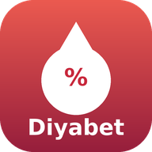
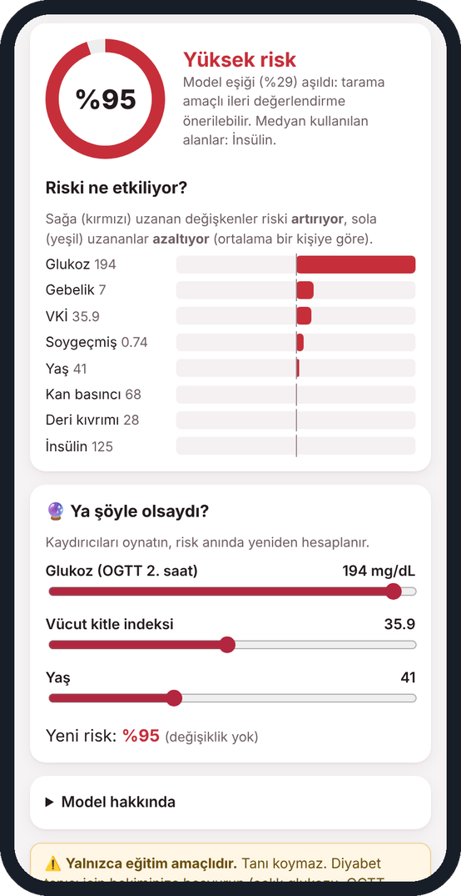
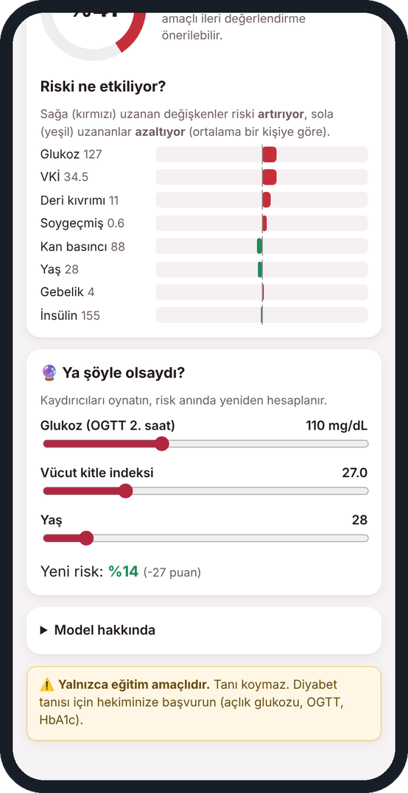
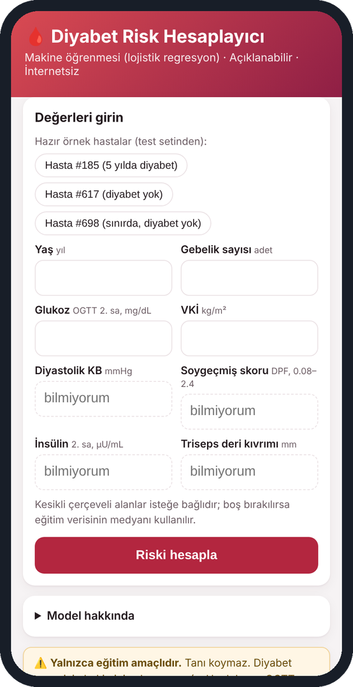
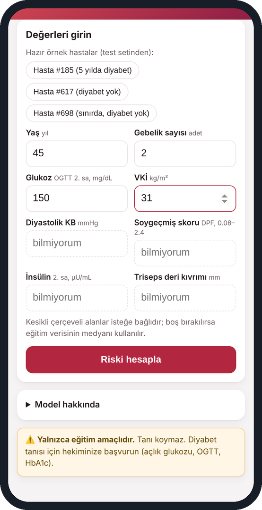
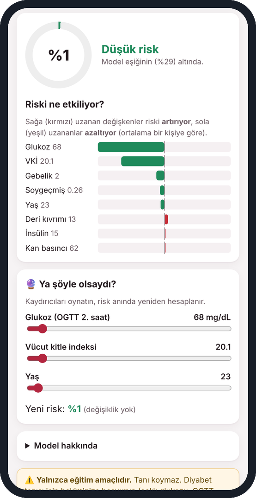
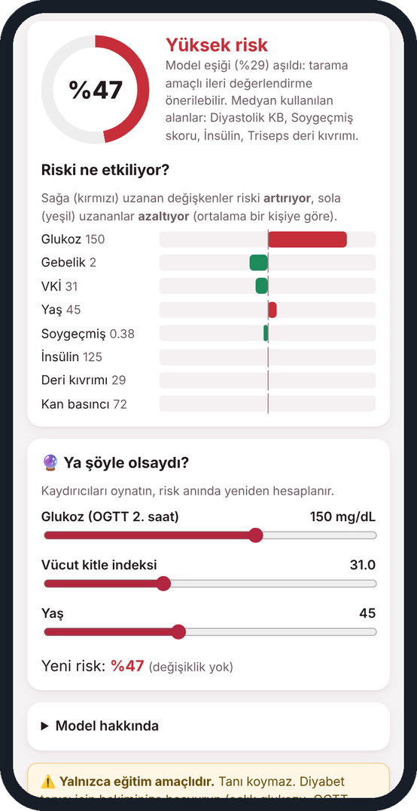
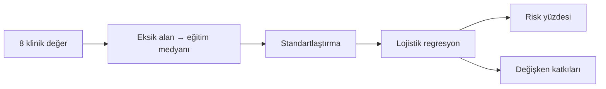

<p align="center"></p>
<h1 align="center">Diyabet Risk YZ</h1>
<p align="center"><i>Klinik değerlerden 5 yıllık diyabet riski</i></p>
<p align="center"><b>Türkçe</b> · <a href="README.en.md">English</a></p>
<p align="center">
  
  
  
</p>

Yaş, gebelik sayısı, glukoz ve VKİ girildiğinde 5 yıl içinde diyabet gelişme riskini yüzde olarak veren, her değerin riske katkısını gösteren ve "ya şöyle olsaydı?" senaryolarını anında hesaplayan eğitim uygulaması.

<p align="center">&nbsp;&nbsp;</p>

> [!IMPORTANT]
> **Yalnızca eğitim amaçlıdır.** Klinik tanı veya tedavi kararında kullanılamaz.

## Özet

| Özellik | Değer |
| --- | --- |
| Paket adı | tr.saglikyz.diyabet |
| Sürüm | 1.0 |
| Gereksinim | Android 5.0 ve üzeri |
| Boyut | 33 KB |
| İnternet izni | Yok — değerler cihazdan çıkmaz |
| Model | Lojistik regresyon (medyan doldurma + standartlaştırma) |
| Eğitim verisi | Pima Indians Diabetes, 576 eğitim kişisi |
| Test başarısı | AUC 0,82 · eşik %29 (duyarlılık ≥ %80) |

**İndir:** [`DiyabetRisk_YZ.apk`](DiyabetRisk_YZ.apk)

## İçindekiler

- [Kurulum](#kurulum)
- [Adım adım kullanım](#adım-adım-kullanım)
- [Hangi değer nereye girilir?](#hangi-değer-nereye-girilir)
- [Sonucu okumak](#sonucu-okumak)
- ["Ya şöyle olsaydı?"](#ya-şöyle-olsaydı)
- [Uygulama nasıl çalışıyor?](#uygulama-nasıl-çalışıyor)
- [Bilmeniz gerekenler](#bilmeniz-gerekenler)
- [Sorun giderme](#sorun-giderme)
- [Sunumda kullanım](#sunumda-kullanım)
- [Veri ve model](#veri-ve-model)
- [Geliştiriciler için](#geliştiriciler-için)

## Kurulum

Uygulama Play Store'da değildir; APK dosyasıyla doğrudan kurulur. Android 5.0 ve üzeri gerekir.

1. `DiyabetRisk_YZ.apk` dosyasını telefona aktarın (WhatsApp, e-posta, Google Drive veya USB kablo).
2. Telefonda **Dosyalar** veya **İndirilenler** klasöründen APK'ya dokunun.
3. "Bilinmeyen uygulamaları yükle" uyarısı çıkarsa **Ayarlar**'a dokunun, dosyayı açtığınız uygulama (ör. Dosyalar, Chrome) için **Bu kaynaktan izin ver**'i açın ve geri dönün.
4. **Yükle**'ye dokunun. Play Protect "tanınmayan geliştirici" uyarısı verirse **Ayrıntılar → Yine de yükle**'yi seçin.
5. Uygulama simgesi ana ekranda veya uygulama listesinde görünür.

**Bilgisayarda açmak için:** `mobil/www/index.html` dosyasını Chrome veya Edge ile açın; kurulum ve internet gerekmez. Sunumda projeksiyona yansıtmanın en kolay yolu budur (telefon görünümü için F12 → cihaz simgesi).

## Adım adım kullanım

1. Uygulamayı açın. En üstteki üç düğme test setinden gerçek hastalardır (#185 diyabet gelişti, #617 gelişmedi, #698 sınırda); biri seçilince alanlar dolar ve risk hemen hesaplanır.
2. Kendi değerlerinizi girmek için düz çerçeveli dört alanı doldurun: **Yaş, Gebelik sayısı, Glukoz, VKİ**. Bunlar zorunludur.
3. Kesikli çerçeveli dört alan (kan basıncı, soygeçmiş skoru, insülin, deri kıvrımı) isteğe bağlıdır; boş bırakılırsa eğitim verisinin medyanı kullanılır ve sonuçta bu belirtilir.
4. **Riski hesapla**'ya dokunun.

<p align="center">&nbsp;&nbsp;</p>
<p align="center"><sub>Şekil 1. Sol: açılış ekranı ve örnek hasta düğmeleri. Sağ: yaş 45, gebelik 2, glukoz 150, VKİ 31 elle girilmiş.</sub></p>

## Hangi değer nereye girilir?

| Alan | Birim | Not |
| --- | --- | --- |
| Glukoz | mg/dL | Oral glukoz tolerans testinin **2. saat** değeri; açlık glukozu değil |
| VKİ | kg/m² | Kilo / boy² |
| Diyastolik KB | mmHg | Alttaki (küçük) tansiyon |
| Soygeçmiş skoru | 0,08–2,4 | Diabetes Pedigree Function; aile öyküsüne dayalı skor, bilinmiyorsa boş bırakın |
| İnsülin | µU/mL | OGTT 2. saat serum insülini |
| Triseps deri kıvrımı | mm | Kaliperle ölçüm |

## Sonucu okumak

Halka riski yüzde olarak gösterir: **%15'in altı düşük** (yeşil), **%15 ile %29 arası orta** (sarı), **%29 ve üzeri yüksek** (kırmızı). %29 eşiği, tarama amaçlı olduğu için diyabet gelişecek kişilerin en az %80'ini yakalayacak şekilde seçildi.

**Riski ne etkiliyor?** çubukları ortalama bir kişiye göre farkı gösterir: sağa uzanan kırmızı çubuk riski artıran, sola uzanan yeşil çubuk riski azaltan değerdir. Çubuklar etki büyüklüğüne göre sıralanır; çoğu kişide en uzun çubuk glukozdur.

<p align="center">&nbsp;&nbsp;</p>
<p align="center"><sub>Şekil 2. Sol: hasta #185, %95 yüksek risk. Sağ: hasta #617, %1 düşük risk.</sub></p>

## "Ya şöyle olsaydı?"

Sonuç kartının altındaki üç kaydırıcıyla glukoz, VKİ ve yaşı değiştirin; yeni risk ve başlangıca göre puan farkı anında görünür. Formdaki değerler değişmez. Örnek: hasta #698'de VKİ 34,5'ten 27'ye ve glukoz 127'den 110'a inince risk %41'den %14'e düşer (−27 puan).

<p align="center">&nbsp;&nbsp;</p>
<p align="center"><sub>Şekil 3. Sol: elle girilen değerlerle %47 risk ve medyan kullanılan alanlar notu. Sağ: kaydırıcılarla yeni risk %14.</sub></p>

Bu bölüm hasta eğitiminde risk iletişimini göstermek için uygundur; ancak model nedensellik iddia etmez, yalnızca ilişkiyi yansıtır.

## Uygulama nasıl çalışıyor?



## Bilmeniz gerekenler

- Model yalnızca **21 yaş üstü Pima kadınlarından** öğrendi; erkeklere, gebeliğe ve Türk toplumuna doğrudan genellenemez.
- Gençlerde ve obez olmayanlarda model daha az duyarlıdır (not defteri 2.4, alt grup analizi).
- Tanı koymaz: tanı için açlık glukozu, OGTT ve HbA1c gerekir.

## Sorun giderme

| Sorun | Çözüm |
| --- | --- |
| "Uygulama yüklenmedi" | Aynı paket adıyla eski bir sürüm var: önce eskisini kaldırın, sonra tekrar yükleyin. |
| "Bu tür dosya cihazınıza zarar verebilir" | Tarayıcının indirme uyarısıdır; **Yine de indir** deyin. Uygulama internet izni istemez. |
| Kurulumda Play Protect uyarısı | **Ayrıntılar → Yine de yükle**. |
| "Lütfen doldurun" uyarısı | Yaş, gebelik, glukoz ve VKİ zorunludur; gebelik yoksa 0 yazın. |

## Sunumda kullanım

Hasta #698 ile başlayın ve "Ya şöyle olsaydı?" kaydırıcılarını canlı oynatın; öğrencilere "bu farkı hastaya nasıl anlatırdınız?" diye sorun.

## Veri ve model

| Yöntem (test seti, 192 kişi) | AUC | %95 GA |
| --- | --- | --- |
| Kural: glukoz ≥ 140 | 0,78 | — |
| **Lojistik regresyon — uygulamadaki model** | **0,82** | 0,77–0,88 |
| Gradyan artırma | 0,82 | 0,76–0,88 |
| Rastgele orman | 0,82 | 0,75–0,88 |

Veri seti: *Pima Indians Diabetes Database* (NIDDK; UCI ML Repository), 768 kadın. Biyolojik olarak imkânsız sıfır değerler (glukoz, kan basıncı, VKİ, insülin, deri kıvrımı) eksik veri olarak işlendi. Ayrıntılar: not defterleri 2.1–2.4.

## Geliştiriciler için

### Klasör yapısı

```
02_Diyabet/
├── 2_1_Veriyi_Tanimak.ipynb
├── 2_2_Ilk_Model_Lojistik_Regresyon.ipynb
├── 2_3_Model_Karsilastirma_ve_Klinik_Fayda.ipynb
├── 2_4_Aciklanabilirlik_ve_Mobil.ipynb   ← modeli mobil/www/model.js'e aktarır
├── veri/  diabetes_orijinal.csv · diyabet_temiz.csv
├── model/ diyabet_lr.json                 ← katsayılar, medyanlar, eşik
├── mobil/
│   ├── www/  index.html · risk.js · model.js
│   ├── ikon.png
│   └── apk_derleme/
└── DiyabetRisk_YZ.apk
```

### APK'yı yeniden derlemek

Uygulama, `mobil/www/` içindeki HTML + JavaScript'i gösteren çok küçük bir Android WebView kabuğudur; Gradle veya Android Studio gerekmez. Ubuntu/Debian'da:

```bash
sudo apt install android-sdk android-sdk-platform-23 openjdk-17-jdk
./mobil/apk_derleme/build_apk.sh mobil/www tr.saglikyz.diyabet "Diyabet Risk YZ" "#8f1f45" mobil/ikon.png DiyabetRisk_YZ.apk
```

`mobil/apk_derleme/saglikyz.keystore` yalnızca eğitim için oluşturulmuş bir imza anahtarıdır (parolası betikte yazılıdır). Uygulamayı dağıtacaksanız kendi anahtarınızı üretin: `keytool -genkeypair -keystore benim.keystore -alias benim -keyalg RSA -keysize 2048 -validity 10000`.

### Modeli yeniden eğitmek

Model dosyaları (`mobil/www/*model*.js`) not defterlerinin son bölümünde üretilir. Not defterini baştan çalıştırıp yukarıdaki derleme komutunu tekrarlamak yeterlidir. Not defteri, telefondaki JavaScript motorunun Python modeliyle aynı sonucu verdiğini de otomatik olarak doğrular.

## Lisans ve atıf

Kod ve kılavuz eğitim amacıyla paylaşılmıştır. Kullanılan veri setleri kendi lisanslarına tabidir; yayınlarda veri setinin özgün kaynağına atıf yapın. Uygulamanın verdiği sonuçlar tıbbi tavsiye değildir.
